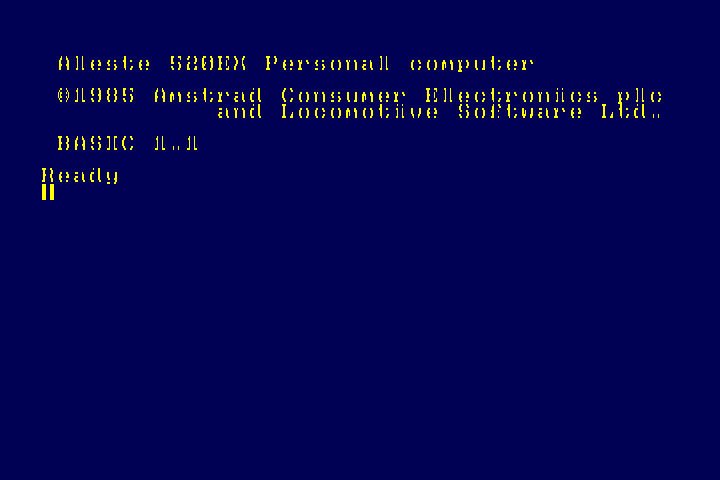
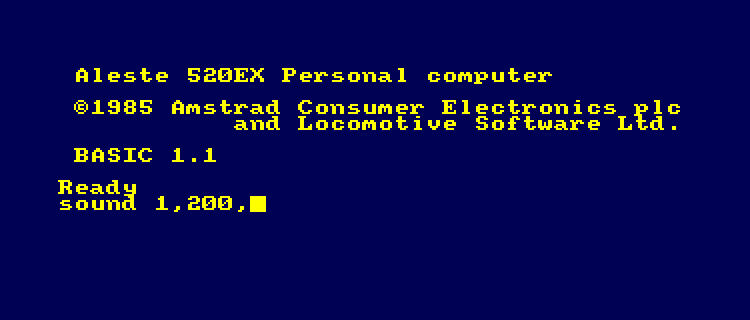
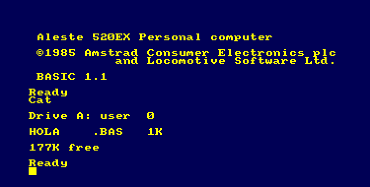

# Fase 3a: modo CPC del Aleste 520EX (hasta BASIC)

El core arranca la ROM original del 520EX (`AL512.BIN`) en el modo CPC de la
MMU del Aleste LX y llega a BASIC 1.1. En simulacion, a los ~300 ms de
encender:



## Como arranca

`ALESTE.ROM` = `BOOT520.BIN` (16 KB, nuestro) + `AL512.BIN` (64 KB). El
cargador pone los primeros 16 KB en `C00000` (arranque de la MMU nativa) y
el resto en `400000` (ROMs del modo CPC). `BOOT520.BIN` solo pasa la MMU a
modo CPC y la CPU sigue en `0000h` con la ROM baja del CPC, como tras el reset
de un 520EX (detalle en `tools/make_rom.py`).

```
copy /b BOOT520.BIN + AL512.BIN ALESTE.ROM          (Windows)
cat BOOT520.BIN AL512.BIN > ALESTE.ROM              (Linux/macOS)
python3 tools/make_rom.py AL512.BIN -o ALESTE.ROM   (comprueba el CRC)
```

Opcion del OSD **CPC boot**: con "AMSTRAD (Shift)" (por defecto) se simula
SHIFT pulsado los primeros 2,5 s, y el SETUP del 520EX (ROM 3) deja el
ordenador en BASIC. Con "520EX SETUP" intenta arrancar MSX-DOS desde disco,
que aun no hay.

## Que se ha anadido

En `aleste_core.sv`:

- **Gate Array**: reconoce en un ciclo las escrituras RMR/MMR (7Fxx con D7=1;
  los registros estan en la MMU) y el modo grafico va al CRTC.
- **PPI 8255** (`i8255_wb` del Aleste LX) en F4xx-F7xx. PB: VSYNC del CRTC,
  marca Amstrad, 50 Hz, impresora lista.
- **PSG minimo**: solo la lectura del registro 14 (el teclado del CPC se lee
  por el puerto A del AY). Lo sustituye el YM2149 en la fase 3b.
- **Interrupciones del Gate Array**: una cada 52 HSYNC, sincronizadas con el
  VSYNC, reconocimiento con INTA y puesta a cero con RMR D4. Salen 300 por
  segundo, como en un CPC.
- E/S CPC sin dispositivo (disco, impresora) y el ciclo INTA responden FF al
  momento en vez de esperar al watchdog.

## Fallos del Aleste LX corregidos para el modo CPC (`tools/gen_rtl.py`)

| Fichero | Problema | Efecto |
|---|---|---|
| `mmu_legacy.sv` | Peticion al bus registrada con el reloj de la CPU (la nativa es combinacional) | WAIT llega tarde: la CPU leia 00 (NOP) en cada instruccion |
| `mmu_legacy.sv` | Las escrituras al Gate Array (7Fxx) no salen al bus | La paleta no cambia nunca |
| `mmu_legacy.sv` | ROMs: baja en FC/7F0000 y numero de ROM alta directo | Se adapta al 520EX: AL512 en 400000 y recodificacion de la PROM D62 (7 -> AMSDOS, 3 -> SETUP, resto -> BASIC) |
| `mc6845mod.sv` | Chip select con A14=1 | El CRTC responderia al Gate Array y a la PPI |
| `mc6845mod.sv` | Direccion de pantalla con RA[3:0] | La pantalla de C000 salia de 18000 |
| `mc6845mod.sv` | Modos del Gate Array solo con R18 bit 5, y conversion de modo invertida | Modos 0/1/2 del CPC mal |
| `pixel_pipeline.sv` | Modo 1: bits de la tinta cambiados | Tintas 1 y 2 cambiadas (texto cian en vez de amarillo) |
| `cpc_colors.sv` | 27 colores indexados como tintas del firmware | El Gate Array usa el numero hardware 0-31: colores equivocados. Tabla de la PROM D62 del 520EX |
| `z80_system.sv` | Sin senal de INTA | Necesaria para las interrupciones del Gate Array |

## Simulacion

```
cd sim
make fase3 AL512=/ruta/AL512.BIN PLUSARGS="+ms=500"
```

Carga el ROM, simula y guarda un cuadro cada 100 ms (`obj3/cpc_*.png`).
Informa de modo CPC, PC, interrupciones, registros del CRTC y errores de bus.
`+trace_cpu=N` saca los primeros N accesos de la CPU; `+trace_io` la E/S CPC.

## Pendiente

- **3b**: teclado PS/2 (matriz del CPC + fila 10 del Aleste) y AY-3-8910 con
  sonido por I2S.
- **3c**: disquetera (uPD765, imagenes DSK desde la SD).
- **3d**: lo propio del 520EX: puerto FABF, mapper MSX, alta resolucion,
  RTC y 8253.
- ~~El barrido de salida es de 60 Hz~~: resuelto, el modo CPC tiene video
  con la temporizacion real (50 Hz, 15 kHz o 31 kHz). Ver `doc/video.md`.

## Fase 3b: teclado y sonido

- **Teclado** (`rtl/cpc/kbd_520ex.sv`): PS/2 (de `user_io`) a la matriz del
  CPC mas la fila 10 del 520EX. La CPU la lee como en el CPC: PC3..PC0 de la
  PPI eligen la fila y el dato entra por el puerto A del AY.
  - Letras, numeros y simbolos en la posicion del CPC; `=` es `^`, `[` es
    `@`, `]` es `[`, `\` es `]`, `'` es `;` y `;` es `:`.
  - F1-F5: F1-F5 del 520EX; F6-F10: SHIFT + F1-F5 (como en la maquina).
  - F11: HELP; Fin (End): Ъ; Insert: INS; Alt: ALT (COPY del CPC).
  - F12 es la tecla del OSD: al pulsarla se sueltan todas las teclas del core.
  - `` ` `` (a la izquierda del 1) y AltGr: R/L (ruso/latino).
  - Teclado numerico: f0-f9 y f.; Supr: BS (CLR); Retroceso: DEL.
  - Joystick 1 de MiST: fila 9.
- **AY-3-8910**: el YM2149 del Aleste LX (MikeJ/Sorgelig), a 1 MHz, con BDIR
  y BC1 en PC7/PC6 y el dato por el puerto A de la PPI, como en el CPC.
  `tools/gen_rtl.py` le corrige dos cosas (senales usadas antes de declararse
  y la lectura del registro 15).
- **Audio**: por I2S en la Poseidon. OSD: *Audio: Mono / Stereo ABC*
  (estereo como el CPC: A a la izquierda, C a la derecha, B en el centro).
- **SHIFT de arranque** (opcion *CPC boot*): se mantiene 0,6 s (BASIC sale a
  los 0,3 s) y se suelta al pulsar una tecla. Antes duraba 2,5 s y lo que se
  escribia al principio salia con SHIFT.

Comprobado en simulacion (`tb_fase3.sv`, `+type=...`): se teclea
`sound 1,200,100` + RETURN con codigos PS/2 y el AY da 310 Hz en el canal A
(periodo 200: 1 MHz / 16 / 200 = 312,5 Hz), volumen 12. Lo que se teclea en el
primer segundo tras el arranque se pierde (el firmware aun no lee el
teclado); por eso la prueba empieza a los 1,2 s.



En la placa: escribir `SOUND 1,200,100` en BASIC debe dar un tono de 1 s.

## Fase 3c: disquetera

- **Controlador**: `rtl/cpc/u765.sv`, el uPD765 de Amstrad_MiST (gyurco) con
  la salida INT que se le anadio para NewBrain, mas soporte de imagenes en
  bruto. Se genera con `tools/gen_u765.py` desde `rtl/cpc/orig/u765.sv`.
- **Puertos** (los del CPC y del 520EX): `FB7E` estado, `FB7F` datos, `FA7E`
  motor (D0). La INT del controlador va a PB1 de la PPI (/DISCINT, activa a 0).
- **Dos unidades** (A y B). En el OSD: *Mount Drive A:* / *Mount Drive B:*
  (`.DSK`, `.IMG`) y *Disk speed: Original / Fast*.

### Formatos de imagen

Al montar, el controlador lee el primer bloque y mira la firma:

| Primer byte | Formato |
|---|---|
| `E` (`EXTENDED CPC DSK File`) | EDSK |
| `M` (`MV - CPCEMU Disk-File`) | DSK estandar |
| otro | imagen en bruto (raw) |

En una imagen raw la geometria sale del tamano, en bloques de 512 bytes (lo
que sobre de un multiplo de 512 se ignora; `msx-games.dsk` trae 16 bytes de
mas al final):

| Bloques | Pistas | Caras | Sectores | Tipico |
|---|---|---|---|---|
| 1440 | 80 | 2 | 9 | MSX-DOS 720 KB (los discos del 520EX) |
| 720 | 80 | 1 | 9 | MSX 360 KB |
| 1600 | 80 | 2 | 10 | 800 KB |
| 1280 / 640 | 80 | 2 / 1 | 8 | 640 / 320 KB |
| 360 | 40 | 1 | 9 | 180 KB |
| otro | 80 | 2 si pasa de 720 | 9 | |

La cabecera de cada pista no se lee: se genera (sectores de 512 bytes
numerados de 1 a N, como en MSX y PC; C = pista, H = cara). Los datos de la
pista estan en (pista * caras + cara) * sectores * 512.

### Conversor de imagenes raw a EDSK

`tools/raw2edsk.py` (como `raw2dsk.py` de NewBrain, pero autonomo y con la
geometria del 520EX). El core monta las imagenes raw directamente, pero el
EDSK es el formato que entienden todas las herramientas y emuladores de CPC.

```
python3 tools/raw2edsk.py alestedos-dev.dsk          -> alestedos-dev.edsk.dsk
python3 tools/raw2edsk.py *.dsk -d edsk/ -v          -> carpeta entera, con el directorio
python3 tools/raw2edsk.py juego.raw --cpc-data       -> raw de CPC (sectores C1-C9)
```

La geometria sale del sector de arranque FAT (MSX-DOS) y, si no hay, del
tamano; se puede forzar con `--cyls --heads --spt --secsize`. Sectores 1-N por
defecto; `--cpc-data` (C1-C9) y `--cpc-system` (41-49) para imagenes de CPC.
Con `-v` lista el directorio (FAT12 de MSX-DOS o AMSDOS). Comprobado con los
tres discos de hww: el core monta los EDSK resultantes y cada sector leido es
igual al del raw original.

### Pruebas

- **Controlador solo** (`make u765 IMG=... C= H= R=`, `sim/tb_u765.sv`):
  simula la SD del firmware y hace SPECIFY, RECALIBRATE, SEEK, READ ID y
  READ DATA. Comparado con el fichero:
  - raw: `alestedos-dev.dsk` (pista 0 sector 1; pista 5 cara 1 sector 7),
    `mag-player.dsk` (pista 79 cara 1 sector 9), `msx-games.dsk` (con los 16
    bytes de mas): todos iguales.
  - EDSK y DSK de CPC (formato DATA, sectores C1-C9): pistas 0, 3 y 39,
    iguales. Lo que ya funcionaba sigue igual.
- **Sistema** (`tb_fase3.sv +dsk=...`): BASIC del 520EX, disco AMSDOS (EDSK)
  montado en A, se teclea `cat`: AMSDOS lee los sectores de directorio C1-C4
  y lista `HOLA    .BAS  1K` y `177K free`.



### Fallos encontrados por el camino

- **El INTA del Z80 se tomaba como una lectura de E/S.** Las MMU del Aleste LX
  consideraban E/S cualquier ciclo con IORQ, tambien el reconocimiento de
  interrupcion (M1 + IORQ, sin RD ni WR), que salia al bus como una lectura
  en la direccion del PC. AMSDOS hace `EI` al acabar de leer un sector; si
  habia una interrupcion pendiente, el INTA llevaba el PC `C907`, que para la
  decodificacion del CPC (A10=0, A8=1, A7=0, A0=1) es el registro de datos
  del 765: se comia ST0, la rutina de resultados leia todo desplazado y
  AMSDOS reintentaba sin fin. Ahora solo es E/S con IORQ y RD o WR, como en
  el bus del Z80 (`tools/gen_rtl.py`, mmu_legacy y mmu_native).
- **Reloj del 765.** En Amstrad_MiST/MiSTer el u765 recibe ce a 8 MHz con
  `CYCLES=4000` (cada ce alterna entre las dos unidades). Aqui: ce = 54/7 =
  7,71 MHz y `CYCLES=3857`, para 32 us por byte y 200 ms por vuelta.
- **Accesos de la CPU al 765.** Cada acceso dura 3 ce y entre dos hay al menos
  otros 3 en reposo; si no, el 765 (que solo mira RD/WR en sus ce) juntaba
  dos accesos seguidos.

Las herramientas que lo encontraron: `+trace_fdc` (ordenes y resultados),
`+trace_cpu` (lo que recibe y escribe la CPU) y `+trace_ring` (las ultimas
lecturas de la CPU al entrar el 765 en resultados) en `tb_fase3.sv`.
Referencias: Amstrad_MiST, Amstrad_MiSTer y Caprice32-Aleste de hww (su FDC
es el de Caprice32; el AMSDOS del 520EX no usa la INT de la disquetera).

## Fase 3d: modo propio del 520EX (en curso)

Guia: el fuente original del BOOTMENU (ROM 3 de AL512,
`doc/referencias/cpcwiki/AlesteBootmenuRomBank3.asm`), el manual de programacion y
CPCWiki.

### EXTEND PORT (FABC-FABF, solo escritura)

El fuente del BOOTMENU confirma el reparto de CPCWiki (no el del comentario
de la BIOS ni el de MAME): en la rama AMSTRAD escribe 8 ("encendemos la
pantalla") y en la Aleste 4 ("encendemos ALESTE").

| Bit | Funcion |
|---|---|
| D0 | decodificacion de la direccion de video (banco) |
| D1 | alta resolucion: pixel 13,333 MHz, caracter de 8 pixeles |
| D2 | MAPMOD: mapper MSX y paleta RGB directa |
| D3 | pantalla encendida (tras el reset, 0: negro hasta que el BOOTMENU la enciende) |
| D4 | escritura en el 8253: registro = A1..A0, dato = puerto A de la PPI |
| D5 | el puerto A de la PPI va al reloj MC146818 en vez de al AY |

### Lo anadido

- **Mapper MSX** (MMU legacy): con MAPMOD, `7Cxx`-`7Fxx` con D7..6=11 eligen la
  pagina de 16 KB de cada cuarto del Z80 (registro = A9..A8).
- **Memoria en paginas unificadas**: pagina p en p*16 KB (0-63). Las
  configuraciones del CPC usan las mismas (banco b -> paginas 4+4b..7+4b),
  como la PROM MAPPER: modo CPC y mapper ven la misma RAM.
- **Gate Array decodificado solo con A15** (como el 520EX).
- **Reloj MC146818** (`rtl/cpc/rtc146818.sv`) por la PPI: PC2..0 = 2
  direccion, 4 escritura, 5 lectura. Hora en marcha, bateria bien (VRT),
  50 bytes de RAM (empiezan a cero).
- **8253**: por ahora solo guarda sus registros (el canal 2 mezcla colores en
  los modos de 2 y 4 colores; pendiente).
- **PB1 = INT de la disquetera, activa a 1**: el BOOTMENU espera el fin de cada
  busqueda con `BIT 1,A ; JR Z` (CPCWiki la llama /DISCINT; la polaridad
  buena es la del fuente).
- **Video de alta resolucion** (manual, 3.3 y 3.4):
  - modos 0/1: 16 KB, 1 byte por caracter, direccion `{MA13..12, RA2..0, MA10..0}`
  - modos 2/3: 32 KB, 2 bytes por caracter, `{MA13, RA0, RA2..1, MA10..0, byte}`
  - modo 0 640x200 2 colores, 1: 320x200 4, 2: 640x200 4, 3: 320x200 16
  - con MAPMOD la tinta es RGB directo `RRGGBB` (64 colores)
  - con R0=6B la linea dura 64,8 us (15,4 kHz) y el cuadro 312 lineas (~49 Hz)

### En simulacion (`tb_fase3.sv +no_shift +dsk=alestedos-dev.dsk`)

El BOOTMENU sigue su fuente: activa el modo Aleste, se copia a otra pagina,
reparte la memoria con el mapper, inicializa el 8253, lee el reloj (bateria
bien), comprueba las sumas de la BIOS/BDOS de MSX-DOS (no cuadran: primer
arranque), dibuja su pantalla y carga `BIOS.SYS` y `BDOS.SYS` del disco raw
con sus propias rutinas de disco.


Cada sector tarda de 20 a 200 ms: el BOOTMENU lee de uno en uno y, si no
llega a pedir el siguiente antes de que pase bajo la cabeza, espera casi una
vuelta (en un disco sin entrelazado la maquina real hace lo mismo).

## Zona visible (OSD)

`cpc_video` genera HBlank/VBlank para `mist_video` como un monitor y como el
`crt_filter` del core Amstrad: fijos respecto a los sincronismos de salida, de
12,25 a 60,25 us tras el HSYNC (768 pixeles de modo 2) y de la linea 30 a la
302 tras el VSYNC (273 lineas). Sin ellas `mist_video` tomaba toda la linea
como visible y el OSD salia desplazado. Vale igual en alta resolucion.
