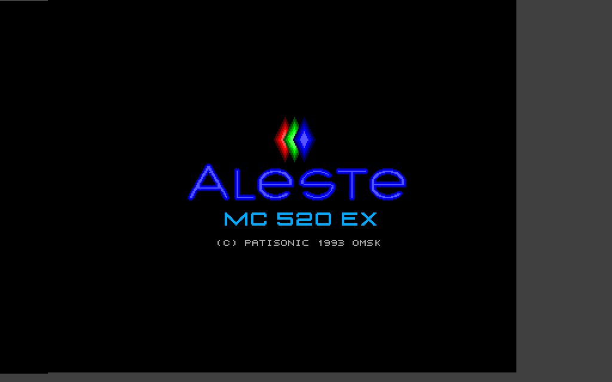
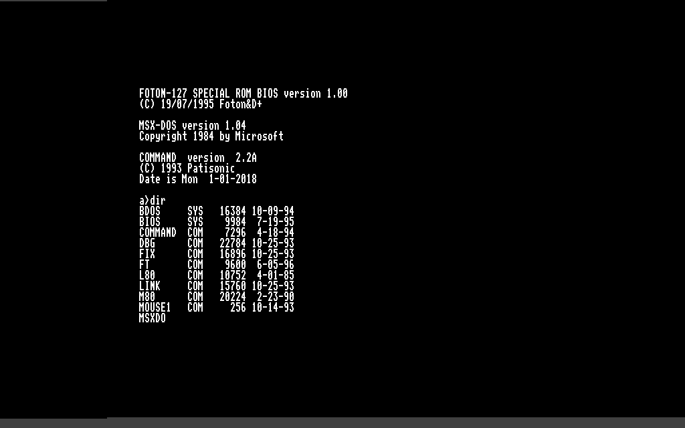
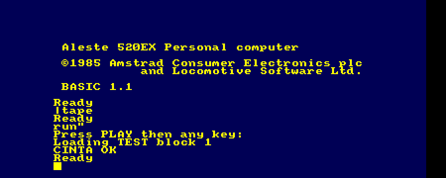
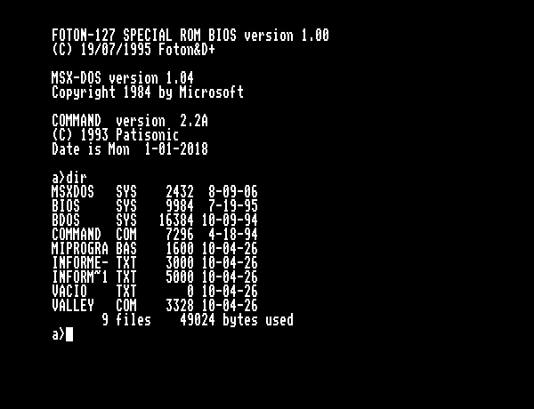

# Fase 3d: modo propio del Aleste 520EX (MSX-DOS)

Sin SHIFT al arrancar, el BOOTMENU (ROM 3 de AL512) pone el 520EX en su modo
propio y carga MSX-DOS del disco. Todo lo de esta fase sale de su fuente
original (`doc/referencias/cpcwiki/AlesteBootmenuRomBank3.asm`), que manda sobre las otras
descripciones cuando no coinciden.



(Pantalla del BOOTMENU en alta resolucion mientras carga MSX-DOS, en
simulacion.)

## Lo que hace el BOOTMENU

1. `FABF=4` (modo Aleste), se copia a la pagina 7 y reparte la memoria con el
   mapper (paginas 4-7).
2. Inicializa el 8253 y lee el reloj: registro D (bateria) y E (disco de
   arranque).
3. Compara las sumas de la BIOS y la BDOS de MSX-DOS (paginas 8 y 9) con las
   guardadas en el reloj (registros 3C-3F). Si no cuadran (siempre en el primer
   arranque) va a `RE_BOOT`: pantalla en alta resolucion, carga `BIOS.SYS` y
   `BDOS.SYS` del disco y guarda las sumas en el reloj.
4. Mapea la pagina 8 en 0000 y salta a la BIOS de MSX-DOS.

En simulacion (`tb_fase3.sv +no_shift +dsk=alestedos-dev.dsk`, la imagen raw
de 720 KB de hww): llega a la BIOS de MSX-DOS a los 8,9 s, carga
`COMMAND.COM` y responde a `dir`:



## Hardware anadido

| Pieza | Donde | Notas |
|---|---|---|
| EXTEND PORT `FABC-FABF` | `aleste_core.sv` | D0 banco de video, D1 alta resolucion, D2 MAPMOD, D3 pantalla encendida, D4 escritura al 8253, D5 reloj en el puerto A de la PPI. A 0 tras el reset (pantalla apagada hasta que el BOOTMENU escribe 8 o 4) |
| Mapper MSX | `mmu_legacy` (`gen_rtl.py`) | Con MAPMOD, escrituras con D7..6=11 a `7Cxx-7Fxx`: registro = A9..A8 (cuarto del Z80), pagina = D5..D0 |
| Paginas unificadas | `mmu_legacy` | Pagina p en p*16K (0-63, 1 MB). La ampliacion del CPC usa las mismas (banco b = paginas 4+4b..7+4b), como la PROM MAPPER |
| Gate Array por A15 | `mmu_legacy`, `aleste_core.sv` | Como en el 520EX (CPCWiki) |
| Reloj MC146818 | `rtl/cpc/rtc146818.sv` | Por la PPI con FABF D5=1: PC2..0 = 2 direccion, 4 escritura, 5 lectura. Hora en marcha, bateria "bien", 50 bytes de RAM (empiezan a cero) |
| Lectura del mapper | `aleste_core.sv` | Leer `7Cxx-7Fxx` devuelve `C0 \| pagina` del cuarto (A9..A8). La BIOS FOTON guarda los registros leyendolos y los restaura escribiendo lo leido; con FF restauraba la "pagina 63" en C000-FFFF, perdia su pila y se reiniciaba cada cuadro |
| 8251 en reposo | `aleste_core.sv` | `EExx` datos (00), `EFxx` estado 85h (TxRDY, TxEMPTY, DSR; sin dato ni errores). La interrupcion de la BIOS lo lee en cada cuadro; con FF veia errores y "caracter recibido" siempre |
| 8253 | `aleste_core.sv` | Por ahora solo guarda lo que se escribe (registro = A1..A0 de FABx, dato = puerto A de la PPI) |
| PB1 = INT de la disquetera | `aleste_core.sv` | **Activa a 1**: el BOOTMENU espera el fin de una busqueda con `BIT 1,A ;DISKINT` / `JR Z`. CPCWiki la llama /DISCINT |
| Video de alta resolucion | `rtl/cpc/cpc_video.sv` | Ver abajo |

## Video en modo Aleste

Del manual de programacion (3.3 y 3.4) y de lo que hacen la BIOS de MSX-DOS y
el BOOTMENU:

| FABF D1 | Registro de modo | Modo del 520EX | Memoria |
|---|---|---|---|
| 0 | 2 | 0: 640x200, 2 colores (texto de 80 columnas) | 16 KB, como el CPC |
| 0 | 1 | 1: 320x200, 4 colores | 16 KB, como el CPC |
| 1 | 1 (o 2) | 2: 640x200, 4 colores | 32 KB |
| 1 | 3 (o 0) | 3: 320x200, 16 colores (logotipo del BOOTMENU) | 32 KB |

- Los modos 0 y 1 son los del CPC en resolucion normal ("los dos primeros
  existen en modo AMSTRAD"), con su direccionamiento.
- Alta resolucion (FABF D1; la BIOS pone siempre D1 y D0 juntos): pixel de
  13,333 MHz (80/6), caracter de 8 pixeles (CRTC a 1,667 MHz), 2 bytes por
  caracter, direccion `MA13, RA0, RA2..1, MA10..0, byte` (las lineas impares
  de cada caracter en +16 KB). Codificacion de los pixeles como en el CPC:
  4 colores = modo 1 del CPC (4 pixeles por byte), 16 colores = modo 0 del CPC
  (2 pixeles por byte).
- MAPMOD (FABF D2): las tintas son RGB directo de 6 bits (R = D5..D4,
  G = D3..D2, B = D1..D0); sin MAPMOD, colores del CPC por la PROM D62.
- FABF D3 = 0: pantalla en negro.

Corregido tras probar `NC` en la placa: la alta resolucion con el registro de
modo a 1 se trataba como un modo de 16 KB y 1 byte por caracter, que no existe.
Probado con `sim/tb_vid.sv` (patron fijo: 1 de cada 4 pixeles en el modo 2,
2 de cada 4 en el modo 3).

## Comprobado

- BASIC en modo AMSTRAD (con SHIFT) sigue igual.
- Sin SHIFT: BOOTMENU, carga de `BIOS.SYS`/`BDOS.SYS` desde la imagen raw y
  salto a la BIOS de MSX-DOS; la pantalla del BOOTMENU sale bien en alta
  resolucion.

## Simulacion rapida de MSX-DOS

`tools/dos_preload.py` saca `BIOS.SYS`/`BDOS.SYS` del disco y calcula la suma
que el BOOTMENU guarda en el reloj (CTRL_SUMM, reproducida instruccion a
instruccion). Con `+preload_dos=CARPETA` el banco de pruebas las deja en las
paginas 8 y 9 y en el reloj: el BOOTMENU salta a la BIOS a los 1,3 s, como un
520EX real a partir del segundo arranque.

```
python3 tools/dos_preload.py alestedos-dev.dsk /tmp/preload
make fase3 AL512=AL512.BIN PLUSARGS="+no_shift +dsk=alestedos-dev.dsk +preload_dos=/tmp/preload +type=dir~ +type_ms=4000 +ms=5500"
```

## Pendiente

- Reloj: este MSX-DOS lo usa en binario (la fecha sale 2018 = 1980 + 0x26);
  el modelo ignora el bit DM del registro B y cuenta en BCD.
- 8253 de verdad: el canal 2 hace el efecto "FUTURE" (duplica colores en los
  modos de 2 y 4 colores durante unas lineas); los canales 0 y 1 dan la
  velocidad del 8251 (serie/raton).
- FABF D0 (banco de VRAM de 64 KB).
- Estados de espera del Gate Array (velocidad exacta del CPC).
- Guardar la RAM del reloj entre arranques.

## MSX-DOS: dos piezas que faltaban (pantalla en negro en la placa)

La BIOS de MSX-DOS arrancaba pero se reiniciaba cada 20 ms y nunca encendia la
pantalla (FABF D3):

- **El mapper se lee.** La BIOS guarda los cuatro registros leyendo `7C`-`7F`
  (01E6) y los restaura escribiendo lo leido (01FD). Se leia FF, se restauraba
  "pagina 63" en C000-FFFF, desaparecian su pila (FCE2) y sus ganchos (FD90...),
  y la CPU resbalaba por ceros hasta 0000. La lectura devuelve ahora
  `C0 | pagina`. (La BIOS mira la pagina con `AND 1Fh`: mapper de 32 paginas.)
- **8251 en reposo.** La interrupcion de la BIOS lee el estado del 8251
  (`EFxx`) en cada cuadro; con FF veia errores y "caracter recibido". Ahora
  responde 85h: TxRDY, TxEMPTY y DSR a 1, sin datos ni errores.

Con las dos, la BIOS escribe FABF=0C (pantalla encendida) a los 1,54 s con
MSX-DOS precargado.

### Simulacion rapida de MSX-DOS

`tools/dos_preload.py` saca BIOS.SYS y BDOS.SYS de la imagen, los deja en
paginas de 16 KB y calcula la suma del BOOTMENU (CTRL_SUMM, reproducida
instruccion a instruccion). Con `tb_fase3 +preload_dos=CARPETA` quedan en las
paginas 8 y 9 y sus sumas en el reloj: el BOOTMENU salta a la BIOS a los 1,3 s
en vez de cargar del disco (9 s), como un 520EX real desde el segundo arranque.
Trazas utiles: `+trace_zero +zero_addr=XXXX` (desde donde se llega a una
direccion), `+trace_pc +pc_hist` (histograma de destinos de salto).

## MagicSound

La placa de sonido de Patisonic que usa el reproductor `MAG.COM` (disco
`mag-player.dsk`). No es el `ms2` del Aleste LX, que es un diseno nuevo e
incompatible: `rtl/cpc/magic_sound.sv` esta hecho a partir del fuente de MAG
(`Aleste520EX/MagicSound/SRC/mag.txt`).

- 4 canales: el contador de cada canal (8254, modo 2, 16 MHz) pide un byte de
  muestra; el 8237 lo lee de la RAM (lectura con autoinicio) y va al DAC del
  canal (8 bits sin signo, MAG convierte las muestras con `XOR 80h`) por el
  volumen (6 bits; D6 = silencio). Al acabar un bloque (TC) da una NMI y el
  reproductor reprograma el bucle.
- Puertos: `F8D0-F8DF` 8237, `F9D8-F9DB` y `F9D4-F9D7` los dos 8254 (canales
  A-C y D), `FAD0-FAD3` volumen, `FBD0-FBDF` mapper de la DMA (canal = A3..A2,
  cuarto de 64 KB = A1..A0, pagina de 6 bits escrita invertida, como dice
  `Documentation/msdesc.txt`; con 5 bits, los canales con muestras en las
  paginas 32-63 leian otra memoria y callaban).
- Reloj de los 8254: 4 MHz, el del bus del Aleste (en el esquema
  `MagicSound/DOC/al-ms-sch-1.pdf`, CLK0-CLK2 de D3 y D4 van a CLK; Caprice32-
  Aleste usa 4 MHz / divisor). Antes iba a 16 MHz: las muestras se consumian
  4 veces mas deprisa y MAG recibia 4 veces mas NMI de fin de bloque.
- En la placa real un unico DAC se multiplexa entre los 4 canales (contador E
  a 1 MHz, registros 4x4 K555IR32 para muestras y volumenes); aqui se suman.
- El mapper de la DMA de la placa es de 5 bits (D11-D12, MAP14-MAP18); aqui se
  guardan 6 porque la RAM del core tiene 64 paginas.
- Mezcla con el AY. *Audio: Mono*: los cuatro canales a los dos lados;
  *Stereo ABC*: A y D a la izquierda, B y C a la derecha (como el Amiga).
- Lee la RAM por el segundo maestro del bus, compartido con el cargador de la SD.

Probado (`sim/tb_ms.sv`) con la secuencia de MAG: 8448 Hz, paginas mapeadas,
NMI cada bloque y estado TC. El EXTEND PORT pasa a decodificarse con A5=1
(`FABx`), para no pisar el volumen (`FADx`).

## Teclado y OSD

F12 abre el OSD del firmware MiST; la tecla Ъ se ha movido a Fin (End) y, al
pulsar F12, el core suelta todas las teclas (si no, la que se soltaba con el
OSD abierto se quedaba pulsada y se repetia).

## SETUP del 520EX y ALESTE.CMO

- **Entrar en el SETUP**: mantener pulsada la tecla BS (CLR) del 520EX al
  arrancar en modo Aleste, que en el teclado del PC es **Supr** (Delete).
  **Esc** pulsada al arrancar obliga a cargar MSX-DOS del disco aunque las
  sumas del reloj cuadren.
- El SETUP guarda su configuracion en la RAM del reloj (registros 0E-3F):
  unidad de arranque, disco RAM, idioma, pantalla, modo, colores, teclado,
  raton, impresora, serie... y pone el reloj en binario (registro B = 06).
- **ALESTE.CMO**: la RAM del reloj guardada en la SD. Es un fichero de 512
  bytes (puede estar a ceros la primera vez) que se monta desde el OSD
  (*Mount CMOS (setup)*, tercera imagen de `user_io`). Al montarlo se cargan
  sus 64 primeros bytes en el reloj; cuando la CPU cambia algo de los
  registros 0A-3F, a los 2 s se escribe el fichero. Asi se conservan el SETUP
  y las sumas de MSX-DOS (el segundo arranque ya no carga del disco).
- La SD se comparte con la disquetera: el CMOS espera a que este quieta.
- Probado en simulacion: con las sumas en el fichero, el BOOTMENU salta a la
  BIOS a los 1,3 s sin leer el disco; un cambio en la RAM del reloj se guarda
  en el fichero a los 2 s.

## Dos disqueteras en MSX-DOS

La BDOS de MSX-DOS cuenta las disqueteras al arrancar recalibrando cada unidad
y mirando la senal de pista 0 (SENSE DRIVE STATUS, ST3 bit 4). El u765 solo la
daba con disco montado: si B: estaba vacia al arrancar, MSX-DOS la tomaba por
inexistente y B: era una unidad fantasma de A: ("Insert diskette for drive B:").
Ahora la senal depende de que la unidad exista (`tools/gen_u765.py`), como en
una disquetera real. En el OSD, *Floppy drives: 2 / 1*.

### Volumen de la MagicSound (MAG.COM real)

El `MAG.COM` del disco no es exactamente la version del fuente `mag.txt`: usa
los mismos puertos y el mismo codigo (mapper invertido, XOR 80h, pagina 0Ah...),
pero escribe el volumen desplazado dos bits (`SLA A` x2: volumen en D7..D2) y
no usa 40h para silenciar. Tomar D6 como silencio (fuente, `msdesc.txt`)
callaba todos los instrumentos con volumen >= 16: solo se oia uno. Ahora el
byte de volumen multiplica la muestra entero, como en Caprice32-Aleste.

## Zona visible en alta resolucion y centrado

La ventana visible que se pasa a `mist_video` (y que centra el OSD) depende de
la resolucion, siempre de 48 us:
- CPC: de 12,25 a 60,25 us tras el HSYNC (zona activa de 16 a 56 us, con
  borde).
- Alta resolucion (tabla MC6845H del BOOTMENU, R0=6Bh, R1=50h, R2=51h): la
  zona activa va de 15,6 a 63,6 us; antes se usaba la ventana del CPC y se
  cortaban unos 5 caracteres por la derecha (SETUP, NC...). Comprobado con
  `sim/tb_vid.sv`: los 640 pixeles de la linea entran enteros.

En el OSD, como en NewBrain: *H centre* (-32 a +24 pixeles, en pasos de 8) y
*V centre* (-8 a +6 lineas, en pasos de 2). Mueven los sincronismos de salida
(lo que mueve la imagen en el monitor); la ventana visible, y con ella el OSD,
queda fija sobre la imagen. (En una primera version movian la ventana, y con
ello el OSD y no la imagen.)

### BDOS de una o dos disqueteras

La rutina DRIVES de la BDOS de MSX-DOS del 520EX detecta la unidad B al
arrancar (la recalibra y guarda la senal de pista 0 en FBF1), pero en
`alestedos-dev.dsk` ese resultado se borra con un `XOR A` antes de usarlo:
siempre declara una sola disquetera fisica y B: es fantasma. En
`msx-games.dsk` ese byte es `OR A`: es la version para dos disqueteras.

`tools/bdos_2drives.py disco.dsk` cambia ese byte (`AF` -> `B7`) buscando la
secuencia exacta, en imagenes raw o EDSK. Con eso, y con el u765 dando la
senal de pista 0 de una unidad presente aunque este vacia, B: es una unidad de
verdad. (La BDOS de `mag-player.dsk` es otra version y no tiene esa deteccion.)

## Montaje automatico al arrancar el core

El firmware de MiST (`user_io.c`, al detectar el core) busca en la raiz de la
SD ficheros con el nombre del core (`ALESTE`, primer campo de CONF_STR):
- `/ALESTE.ROM`: se carga en el indice 0 (la ROM del sistema).
- `/ALESTE.HD0`, `/ALESTE.HD1`, `/ALESTE.HD2`: se montan en las imagenes 0, 1
  y 2 de user_io, es decir, la disquetera A:, la B: y el CMOS (ALESTE.CMO).
  (Solo si no hay un `/ALESTE.VHD`.)
Asi basta con copiar el CMOS como `ALESTE.HD2` (y, si se quiere, un disco como
`ALESTE.HD0`) para que se monten solos en cada encendido.

El firmware hace todo esto con el reset del OSD activo y lo suelta al final.
Por eso el cargador de la ROM no atiende ese reset durante la descarga, y la
logica del CMOS solo usa el reset del PLL (el reloj acepta la carga desde la
SD aunque este en reset). Probado en simulacion: CMOS montado a los 30 ms con
el reset activo, y el BOOTMENU salta a la BIOS con las sumas del fichero.

## Cinta (modo AMSTRAD)

- OSD: *Load tape* (indice 3, ficheros CDT/TZX) y la pagina *Tape & audio* con
  *Tape sound*, *Invert tape in* y *Test tone* (1 kHz, para comprobar el audio).
- El fichero va a la SDRAM en 0x800000 (hasta 4 MB). Lo lee el reproductor
  `rtl/cpc/tzxplayer.sv` (el de gyurco del core Amstrad de MiST, traducido a
  SystemVerilog y comprobado contra el VHDL original con GHDL:
  `sim/tzx_equiv/run.sh`) con los tiempos del CPC, por el segundo maestro del
  bus (compartido con el cargador y la DMA de la MagicSound).
- La senal entra por PB7 de la PPI y el motor es PC4, como en un CPC y en
  Caprice32-Aleste. El firmware explora el teclado tambien mientras espera la
  cinta (para ver ESC): cada palabra de modo del 8255 pone PC4 a 0 un instante.
  Un rele real no lo nota; aqui el motor se mantiene 1 ms tras ver PC4 a 1, para
  que la inercia de 50 ms del reproductor no se reinicie.
- El modo MSX del 520EX no tiene cinta: ni las BIOS (FOTON y las otras) ni la
  BDOS leen PB7, y no hay MSX-BASIC. Por eso no hay carga de CAS.
- `tools/make_cdt.py` fabrica cintas CDT con el formato del firmware del CPC
  (programa BASIC o binario). Tras pulsar la tecla, el firmware espera unos 2 s
  a que el motor coja velocidad: una cinta rapida de simulacion (`--fast`)
  necesita `--lead-ms` para no pasar entera antes.

Probado en simulacion: `|TAPE`, `RUN"`, tecla, "Loading TEST block 1" y el
programa de la cinta escribe CINTA OK:



### Sincronismo de salida a distancia fija de la imagen

Con una ventana visible por resolucion, la imagen empezaba 12,25 us tras el
HSYNC en resolucion normal y 15,6 us en alta resolucion. Un monitor VGA que
ajusta la posicion una sola vez la cortaba por la izquierda al pasar del
logotipo del BOOTMENU (alta) al texto de MSX-DOS o al CPC (normal). Ahora el
HSYNC que sale hacia `mist_video` se genera aparte: 4 us de ancho y siempre
12,25 us antes de la ventana visible con *H centre* a 0 (la distancia de
siempre del CPC). El VSYNC de salida tambien: 4 lineas, 30 lineas antes de la
primera linea visible con *V centre* a 0. Cuando el ajuste pide adelantar el
sincronismo mas alla del principio de la linea (o del cuadro) del Gate Array,
se genera al final de la anterior, con la longitud medida de la linea y del
cuadro. (Una version intermedia usaba 10,25 us y 23 lineas para tener margen,
y un monitor ya ajustado cortaba la imagen por la izquierda.) Comprobado con `sim/tb_vid.sv`: la misma distancia en los dos modos, y
*H centre* / *V centre* la cambian en 0,5 us / 2 lineas por paso.

## Reset y modos de arranque

- El 520EX tiene una tecla **RES** (reset por hardware, fuera de la matriz):
  SHIFT + RES entra en AMSTRAD, la tecla de borrado (BS) + RES en el SETUP, y
  ESC + RES recarga MSX-DOS del disco. Aqui es **Bloq Despl** (Scroll Lock):
  mientras se pulsa el core esta en reset y al soltarla arranca leyendo las
  teclas mantenidas (el teclado ya no se reinicia con el sistema, para que no
  se pierdan).
- `RESET.COM` (disco de MSX-DOS) no reinicia por si mismo: pone la pagina 8
  (la BIOS de MSX-DOS) en 4000h, la rellena con su primer byte (asi la suma del
  reloj ya no cuadra) y hace `DI` / `HALT`. Espera a que se pulse RES; el
  BOOTMENU recarga entonces MSX-DOS del disco.
- OSD *CPC boot*: *Aleste 520EX* (sin teclas: BOOTMENU), *AMSTRAD (Shift)*
  (SHIFT forzado al arrancar) y *Aleste BIOS* (BS forzado: SETUP). La tecla
  forzada dura 2,5 s o hasta pulsar una de verdad.

## Raton serie

El 520EX lleva el raton en el puerto serie (8251). La BIOS de MSX-DOS (FOTON)
lo programa (reset interno 40h, modo 4Eh: 8 bits, sin paridad, 1 bit de
parada, x16; orden 07h; 8253 a 4 MHz / 208 / 16 = 1202 baudios) y en la
interrupcion recoge paquetes **Mouse Systems** de 5 bytes (10000LMR con los
botones activos a 0, dx1, dy1, dx2, dy2; X += dx1+dx2, Y -= dy1+dy2), solo si
el raton esta activado en el SETUP.

`rtl/cpc/serial_mouse.sv`: 8251 (modo, ordenes, estado con RxRDY y
desbordamiento, datos; 40h exacto es siempre reset interno, como espera la
BIOS) y el raton PS/2 de user_io convertido a Mouse Systems, a 1200 baudios
(8,33 ms por byte), solo con la recepcion activada. Probado con
`sim/tb_mouse.sv` y la secuencia de la BIOS: 83 0A 05 00 00 para +10, +5 y el
boton izquierdo.

(`MOUSE1.COM` del disco no es el controlador: ajusta valores de la BIOS.)

### Posicion de la imagen, medida

El doblador de mist_video (`scandoubler_framing`) empieza cada linea al final
del HSYNC de entrada y pone su HSYNC a mitad de escala, asi que la posicion en
31 kHz sale de la de 15 kHz dividida por dos. Medido en `sim/tb_vid.sv` con ese
modulo:

| | 15 kHz: HSYNC -> imagen | 31 kHz: linea | HSYNC | HSYNC -> imagen |
|---|---|---|---|---|
| CPC | 12,24 us | 31,99 us | 1,99 us | 6,11 us |
| Alta resolucion | 12,24 us | 32,39 us | 1,99 us | 6,11 us |
| Imagen de 48/24 us centrada (PAL / 576p) | ~12,5 us | 32,00 us | 2,37 us | 6,22 us |

Los dos modos quedan igual y centrados segun el estandar. (Una version con
margen en alta resolucion desplazaba esa imagen 2 us a la derecha y en 15 kHz
NC se salia; se quito.) Si un monitor VGA corta la imagen, es su ajuste
guardado: restablecer la geometria del monitor para ese modo y hacer el ajuste
automatico con la imagen del CPC (el borde ocupa toda la ventana).

## Disquetes de MSX-DOS desde una carpeta

`tools/make_msxdisk.py` crea una imagen raw de 720 KB (o 360 KB) con el formato
de los discos del 520EX. Probado: leido con otro lector FAT, los ficheros salen
identicos; en simulacion, un disco creado con `--system alestedos-dev.dsk
--2drives` arranca MSX-DOS y `dir` lo lista:



Pendiente: en esa prueba `dir` mostro 9 de los 10 ficheros; falto `VALLEY.DAT`
(su entrada de directorio es correcta y un lector FAT la encuentra). Sin
averiguar todavia si es cosa de MSX-DOS o de la imagen.

### Divisor del doblador segun la resolucion

`mist_video` recibia un divisor de pixel fijo (80/5 = 16 MHz) y en alta
resolucion los pixeles van a 13,33 MHz (80/6): el doblador tomaba 768 muestras
de una linea de 640 pixeles y uno de cada cinco salia doble, asi que el texto
de 640 columnas se leia mal. Ahora el top le pasa 5 (80/6) en alta resolucion
y 4 en el resto (`cpc_video` saca `hires_o`; el doblador recoge el divisor en
cada linea). Medido en `sim/tb_vid.sv` con `scandoubler_framing` y una linea
con un pixel de cada cuatro encendido: 640 muestras y distancia siempre 4
(antes 768 muestras y distancias de 1, 4 y 5). El modo CPC no cambia.

Si aun asi un monitor VGA no lo muestra nitido, el paso siguiente seria la
tecnica de rampa069 en el FP-1100: un 576p propio con reloj enganchado a la
maquina y pixeles 1:1 (en este core, 27,0433 MHz y reenganche de cuadro entre
el modo CPC y la alta resolucion).

## Reloj (MC146818): revision

- El SETUP solo lee la hora si el registro C tiene **UF** (bit 4, fin de
  actualizacion) a 1 (rutina CLOCK). El modelo devolvia siempre 00: los
  campos de fecha y hora del SETUP se quedaban en XX. Ahora UF se pone a 1
  cada segundo y se borra al leer el registro C.
- Registro A: UIP los 244 us antes de cada actualizacion. Registro B: SET para
  la hora. Calendario completo (dias por mes, bisiestos, dia de la semana),
  en binario o BCD segun DM. El ano es "anos desde 1980" (como el SETUP).
- Si la placa tiene reloj, el firmware de MiST manda la hora al core
  (user_io `rtc`): se pone en hora al arrancar y tras cargar el CMOS.
- La hora no se guarda en el CMOS (cambia cada segundo); sin reloj en la placa
  hay que ponerla en el SETUP o con TIME tras cada encendido.
- Probado con `sim/tb_rtc.sv`: UF, cambio de ano y de siglo, 29 de febrero,
  SET, y la hora de MiST.

`msx/TIME.COM` (fuente `msx/time.asm`, `pasmo --bin time.asm TIME.COM`): el
COMMAND.COM 2.2A del 520EX no tiene TIME. Muestra la hora (BDOS 2Ch) o la cambia
(`TIME hh:mm[:ss]`, BDOS 2Dh). Probado en un emulador de Z80 con una BDOS
simulada.

El calendario se actualiza con una maquina de estados (un campo por ciclo y
solo mientras hay acarreo) y en el formato del propio registro (binario o
BCD), sin conversiones. La primera version lo hacia todo en un ciclo, con
divisiones y restos entre 10: en la SiDi era el camino que no cumplia los
54 MHz (-5,1 ns) y ocupaba elementos logicos y multiplicadores.

## Ratones del CPC (modo AMSTRAD)

Los programas de CPC no usan el raton serie del 520EX. Como los cores Amstrad
de MiST y MiSTer, el core emula a la vez, con el raton de MiST, los ratones de
CPC, con los modulos de Sorgelig sin cambios (`rtl/cpc/kempston_mouse.v`,
`symbiface_mouse.v`, `multiplay_mouse.v`, `amx_mouse.v`):
- Kempston: FBEE/FBEF/FAEF (aqui solo FAxx/FBxx con A7=1 y A4=0; la
  decodificacion original, A10 y A4, chocaria con la de la disquetera).
- SYMBiFACE II: FD10. Multiplay: F990-F997. Ninguno choca con el 520EX.
- AMX: al joystick 1 cuando el teclado lee la fila 9.
OSD: *Mouse (CPC)* (activado por defecto, como en MiSTer) y *AMX mouse*.
Sin probar en simulacion; se responde al bus al tercer ciclo porque
SYMBiFACE II y Multiplay cargan el dato en el flanco de subida de la seleccion.

## Cartuchos de MSX en el Aleste (msxrom2aleste)

Como se adaptaron (documentacion de hww, carpeta "VDP Emulator", y la
comparacion de King's Valley con su ROM):
- El cargador .COM instala en la memoria baja una BIOS de MSX compatible (las
  llamadas a WRTVRM, RDVDP, SETWRT... del juego se quedan igual) con un VDP por
  software, y se encarga del mapper, el sonido y el teclado.
- Cada OUT (C),A directo al VDP (ED 79) pasa a NOP + RST 18h (00 DF).
- Lo que depende de la temporizacion del MSX se reescribe a mano: bucle
  principal (esperaba la interrupcion del VDP con RDVDP; ahora llama a 0003h,
  sincronizado con el cuadro del Aleste), gancho de interrupcion, numero de
  sprites, alguna tabla.
- King's Valley (RC-727, md5 c5698102...): 66 bytes en 15 sitios
  (`tools/msxpatches/kingsvalley1.txt`); la herramienta reproduce VALLEY.DAT
  byte a byte.
- Vampire Killer (RC-744): la conversion es del **cartucho europeo** (openMSX
  softwaredb: GoodMSX, sha1 b58e77f8...). Se reconstruyo ensamblando por tramos
  el desensamblado del original de la documentacion de hww (`vkiller.asm.txt`;
  el parcheado ensamblado coincide con VKILLER.1) con las paginas 1-7 de
  VKILLER.2: el sha1 coincide con el del cartucho europeo. La conversion son
  1015 bytes en 61 sitios, todos en la pagina 0 (`tools/msxpatches/
  vampirekiller.txt`). La variante "JoySNES" tiene el codigo desplazado.
- Sustituciones vistas en Vampire Killer: RST 08h + byte = escritura al mapper
  (FDh: 6000h, FEh: 8000h), RST 10h + 00 = OTIR al VDP, RST 18h + 00 =
  OUT (C),A al VDP (en King's Valley, NOP + RST 18h).

## Modo turbo del Z80

El 520EX tenia un modo turbo documentado por hww (Documentation/TurboMode*,
TurboCircuit*): el reloj de la CPU al doble, 8 MHz. OSD *CPU speed*: 4 MHz (por
defecto), 8 MHz o 16 MHz. Es el acumulador de fase del Z80 en modo CPC
(`tools/gen_rtl.py`, z80_system): avanza 4, 8 o 16 de cada 54 ciclos del reloj
del bus. Solo cambia el Z80 (video, sonido, temporizadores y reloj van con sus
relojes). Medido en simulacion: a 16 MHz, 2,5 veces mas instrucciones que a
4 MHz (las esperas de la SDRAM limitan). La cinta solo carga a 4 MHz (el
firmware la temporiza con bucles). Pensado para los juegos de MSX convertidos,
que emulan el VDP por software.
